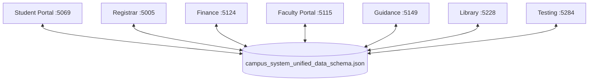

# Campus System: Architecture and Status Guide

This replaces an earlier version that described a MySQL and SQL Server design and listed all 26 issues in `AI_CONTEXT_SYSTEM_ISSUES.md` as resolved. That claim was not true of the code and the datastore it described no longer exists. This version says what is built, checked against the code.

## Architecture

Seven ASP.NET Core apps share one JSON file, `campus_system_unified_data_schema.json`, through `CanonicalJsonStore` (`Shared/CampusSystem.Data/Json`). There is no SQL database and no HTTP calls between departments except `POST /api/finance/assess`.

Rules, ids, the schema version and the ownership table for all 38 collections are in `Shared/CampusSystem.Data/Json/README.md`. Read it before touching data code.

## Workflows that run on shared status fields

These work through the data, with no calls between apps:

| Workflow | How it runs |
| --- | --- |
| Enrollment and assessment | Student Portal or Registrar creates an `enrollments` row and a flat placeholder `fee_assessments` row. Finance replaces the placeholder with real fees from `tuition_fee_matrix` (`POST /api/finance/assess`). |
| Add/drop and fees | Registrar approving an add/drop, or registering and dropping through its API, calls `FeeCalculator.Recalculate`: units, tuition, lab fees, the assessment, the unpaid installments and a `fee_adjustments` row change together. |
| Payment and clearance | Finance records a `student_payments` row, updates the assessment and installments, and sets its row of `student_clearance`. Student Portal payments update the same assessment. Registrar validates enrollment only when a paid payment exists. |
| Grades | Faculty saves a draft grade (or INC) while the encoding window is open. Registrar verifies and locks it. Only non-draft grades reach the student transcript API. |
| Failing grades | A failing grade or INC from Faculty adds a `ReferredIn` row to `guidance_requests`, once per enrolled subject. |
| Exam permit | Faculty's roster reads the Finance row of `student_clearance`. No row means no permit. |
| Coursework | Faculty publish `assignments` for their sections. Student Portal shows them to enrolled students, who add `assignment_submissions`. Faculty score and comment on them. Attendance is `attendance_logs`, one row per student per session. |
| Document requests | Student Portal, Registrar and Finance all use `transcript_requests`. Finance records the fee payment. Registrar processes and releases. |
| Guidance requests | Student Portal files `guidance_requests`. The Guidance API triages them and writes `audit_events`. |
| Library | Librarians (Library app) and students (Student Portal) use the same `LibraryCirculation` rules over `library_books`, `book_loans`, `library_fines` and `library_reservations`. Unpaid fines block borrowing. |

## Sign-in

Accounts are `users` rows with a BCrypt `password_hash`. `AuthStore` (shared) checks the password, locks an account for 15 minutes after five misses, and admits only the roles an app allows. Each app has its own cookie name. Calls between apps use the `X-Campus-Service-Key` header. The README lists the demo accounts and which roles each app admits.

## What is not built

- Registrar's student REST API has no production sign-in. Students sign in to Student Portal, so those endpoints only work with the development test login.
- File uploads for assignments. Answers are text only.
- A database that works across machines. The JSON file is locked by a machine-local mutex.
- Counselor screens. Guidance is an API only.

## Verification

- `Check-Departments.ps1 -ProjectPath . -AllDepartments -Build` checks structure and builds.
- Eight test projects (175 tests) cover the store and shared rules, Finance, Registrar's API, Faculty, Student Portal, Guidance, Library and the Testing browser. See the README for the commands.
